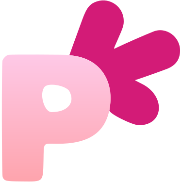

# 면접 기록 서비스 PICK ME

## 목차

1. [**프로젝트 소개**](#프로젝트-소개)
   - [프로젝트 개요](#프로젝트-개요)
2. [**팀 소개**](#팀-소개)
3. [**주요 기능**](#주요-기능)
   - [프론트엔드 프로젝트](#프론트엔드-프로젝트)
   - [백엔드 프로젝트](#백엔드-프로젝트)
4. [**CI/CD**](#cicd)
   - [빌드 워크플로어](#빌드-워크플로어)
   - [Git Flow 전략](#git-flow-전략)
   - [소스 코드 관리 (SCM)](#소스-코드-관리-scm)
5. [**인프라**](#인프라)
6. [**기술 스택**](#기술-스택)

 

## 프로젝트 소개

**PICK ME**는 취업 준비생들이 면접을 효율적으로 준비하고, 면접 과정을 체계적으로 관리할 수 있도록 돕는 웹 서비스입니다.

이 서비스는 면접 일정, 기업 분석, 예상 질문·답변 정리, 면접 회고를 하나의 플랫폼에서 제공하여, 사용자가 면접 준비 전반을 통합적으로 관리할 수 있게 합니다.  
일정 관리와 정보 정리를 넘어, 취업 준비생들이 면접 성공률을 높일 수 있도록 체계적이고 효율적인 준비를 지원하는 목표를 가집니다.

프로젝트 개요

### 프로젝트 개요

#### 타겟층

기업 입사를 목표로 면접 전형을 전략적이고 체계적으로 준비하고 싶은 취업 준비생

#### 문제 정의

현재 취업 준비생은 면접 일정을 별도의 앱이나 다이어리로 관리하고, 기업 분석 및 예상 질문·답변 등을 흩어져서 정리합니다. 이로 인해 면접 준비가 비효율적입니다. 또한, 면접 결과나 회고를 기록하고 분석할 툴이 부족해 전략적인 준비가 어렵습니다. 기존의 채용 플랫폼은 공고 검색과 지원에 집중되어 있어 면접 준비에 필요한 일정, 자료, 회고 관리 기능이 부족합니다.

이를 해결하기 위해 면접 일정 관리, 기업 분석, 예상 질문 정리, 면접 회고까지 한 곳에서 체계적으로 관리할 수 있는 문서 기반 면접 준비 플랫폼을 개발합니다.

#### 기대 효과

- **효율적인 면접 준비**: 일정, 기업 분석, 예상 질문 등을 한 곳에서 관리하여 준비 시간을 절약할 수 있다.
- **데이터 기반 전략 수립**: 면접 회고 및 피드백을 분석하여 개인 맞춤형 면접 전략을 세운다.
- **정보 접근성 향상**: 취업 준비생이 필요한 정보를 보다 체계적이고 쉽게 정리할 수 있어, 준비 과정의 혼란을 줄인다.

 

## 팀 소개

| [김아영](https://github.com/Cameist) | [김영진](https://github.com/yxxngjxn) | [안진수](https://github.com/Awlstn) | [정원철](https://github.com/NarciSource) |
| :-: | :-: | :-: | :-: |
|  |  |  |  |

 

## 주요 기능

PICK ME는 취업 준비생들이 면접 준비를 효율적으로 할 수 있도록 여러 핵심 기능을 제공합니다.

1. 예상 질문과 그에 대한 답변을 기록하며, 사용자가 답변을 준비할 수 있도록 돕습니다.
2. 각 기업의 분석 자료와 면접 팁을 정리하여 사용자가 기업별로 맞춤형 준비를 할 수 있게 지원합니다.
3. 면접 후 회고를 기록하고 분석할 수 있어, 데이터 기반으로 면접 준비를 개선할 수 있습니다.
4. 면접 일정을 관리하고 알림을 통해 중요한 일정을 놓치지 않도록 도와줍니다.
5. 멘토와의 실시간 채팅 기능을 통해 취업 준비생이 언제든지 궁금한 점을 물어보고, 면접 준비에 필요한 조언을 받을 수 있습니다.

### 프론트엔드 프로젝트

마이크로 프론트엔드 아키텍처(_MFA; Micro Frontend Architecture_)를 채택하여 각 애플리케이션은 독립적으로 빌드되고 배포됩니다. 이를 통해 각 팀은 자신만의 책임 범위 내에서 개발할 수 있으며, 애플리케이션의 모듈화와 유지보수성이 향상되었습니다.

각 애플리케이션은 _CDN(Content Delivery Network)_ 을 통해 배포되고, 사용자 브라우저에서 동적으로 통합됩니다.

이 방식은 애플리케이션 간 유연성을 높이고, 기능 추가나 업데이트가 독립적으로 이루어져 시스템의 확장성과 탄력성을 보장합니다.

| 프로젝트명 | 프로젝트 요약 | 기능 |
| --- | --- | --- |
| [PickMe-MFA-Root](https://github.com/Daily1Hour/PickMe-MFA-Root) | 마이크로 프론트엔드 통합 | Single-SPA 응용 프로그램을 시작하는 루트 HTML  마이크로프론트엔드를 동적으로 통합 |
| [PickMe-Style-Guide](https://github.com/Daily1Hour/PickMe-Style-Guide) | 스타일 가이드 | Module Federation을 활용한 컴포넌트 동적 제공  Storybook을 활용한 컴포넌트 문서화 |
| [PickMe-Nav-Application](https://github.com/Daily1Hour/PickMe-Nav-Application) | 네비게이션 마이크로 프론트엔드 | 웹사이트 공통 네비게이션 공간 렌더링 |
| [PickMe-Auth-Parcel](https://github.com/Daily1Hour/PickMe-Auth-Parcel) | 사용자 관리 마이크로 꾸러미 조각 | Amazon Cognito를 이용한 사용자 관리  동적 모듈 호출이 가능한 Parcel 제공 |
| [PickMe-Record-Application](https://github.com/Daily1Hour/PickMe-Record-Application) | 기록 서비스 마이크로 프론트엔드 | 사용자 맞춤 면접 준비 기록 페이지 |
| [PickMe-Review-Application](https://github.com/Daily1Hour/PickMe-Review-Application) | 면접 회고 마이크로 프론트엔드 | 사용자 맞춤 면접 리뷰 페이지 |
| [PickMe-Report-Application](https://github.com/Daily1Hour/PickMe-Report-Application) | 기업 분석 마이크로 프론트엔드 | 사용자 맞춤 기업 분석 페이지 |
| [PickMe-Calendar-Application](https://github.com/Daily1Hour/PickMe-Calendar-Application) | 캘린더 마이크로 프론트엔드 | 면접 일정 관리와 알림 관리 페이지 |
| [PickMe-Reminder-Parcel](https://github.com/Daily1Hour/PickMe-Reminder-Parcel) | 알림 마이크로 꾸러미 조각 | 서비스 워커를 사용하여 OneSignal SDK를 로드  브라우저에서 푸시 알림을 등록하는 Parcel 제공 |
| [PickMe-Chat-Application](https://github.com/Daily1Hour/PickMe-Chat-Application) | 채팅 마이크로 프론트엔드 | 사용자간 실시간 채팅 위젯 |

### 백엔드 프로젝트

마이크로서비스 아키텍처(_MSA; MicroService Architecture_)를 기반으로 설계되어 각 서비스는 독립적으로 배포되고 실행됩니다. 이를 통해 각 서비스는 명확하게 책임이 분리되고, 독립적으로 관리됩니다.

프론트엔드와의 통신은 *RESTful API*를 통해 이루어지며, 서비스 간의 연동이 원활하게 진행됩니다.

모든 서비스는 도커(_Docker_) 이미지를 사용하여 컨테이너화되어 있으며, _AWS_ 인프라를 활용하여 배포됩니다. 또한, 오토스케일링 기능을 통해 트래픽 증가에 따른 리소스를 자동으로 확장할 수 있어, 시스템의 안정성과 확장성을 보장합니다.

| 프로젝트명 | 프로젝트 요약 | 기능 |
| --- | --- | --- |
| [PickMe-Record-Service](https://github.com/Daily1Hour/PickMe-Records-Service) | 기록 마이크로 서비스 | 사전 준비 과정에서 예상 질문과 답변을 정리할 수 있도록 기록하는 서비스 |
| [PickMe-Review-Service](https://github.com/Daily1Hour/PickMe-Review-Service) | 회고 마이크로 서비스 | 면접 후 면접 정보, 진행 과정, 질문과 답변, 의사소통, 분석과 평가 해당 면접에 대해 리뷰하는 서비스 |
| [PickMe-Report-Service](https://github.com/Daily1Hour/PickMe-Report-Service) | 공고 분석 마이크로 서비스 | 사전 준비 과정에서 사용자가 기업 분석을 할 수 있도록 기록하는 서비스 |
| [PickMe-Calendar-Service](https://github.com/Daily1Hour/PickMe-Calendar-Service) | 캘린더 마이크로 서비스 | 사용자가 캘린더에 회사명, 면접 시간, 면접 위치 등 면접 일정을 저장하고 관리할 수 있는 서비스 |
| [PickMe-Reminder-Service](https://github.com/Daily1Hour/PickMe-Reminder-Service) | 알림 마이크로 서비스 | API를 통해 알림 시간을 관리하고, 스케쥴러가 매시간 알림을 발송하는 서비스 |
| [PickMe-Chat-Service](https://github.com/Daily1Hour/PickMe-Chat-Service) | 채팅 마이크로 서비스 | 사용자 간 실시간 채팅을 제공하고 참가 중인 사용자를 관리하는 서비스 |

 

## CI/CD

1. **소스 코드 관리**: Git으로 소스 코드를 관리하고, GitHub에 푸시 후 Pull Request(PR)을 생성합니다.
2. **코드 빌드 및 테스트**: GitHub Actions를 사용하여 코드 빌드, 테스트, 린트를 수행합니다.
3. **PR 승인 및 병합**: main 브랜치는 보호되어 있으며, PR에 대한 리뷰 승인을 받은 후 main 브랜치에 병합됩니다.
4. **도커 이미지 빌드**: AWS CloudBuild에서 도커 컨테이너 이미지를 빌드합니다.
5. **ECR로 이미지 푸시**: 빌드된 이미지를 AWS ECR로 푸시합니다.
6. **컨테이너 배포**: AWS CodeDeploy를 사용하여 ECR에서 이미지를 가져와 컨테이너를 배포하고, ECS에서 실행됩니다.

### 빌드 워크플로어

- [graddle-build](https://github.com/Daily1Hour/PickMe/blob/spring-workflow/.github/workflows/gradle-build.yml)
- [vite-build](https://github.com/Daily1Hour/PickMe/blob/vite-workflow/.github/workflows/vite-build.yml)

1. PR이 열리면 워크플로어를 작동해서 빌드 성공을 확인
2. 빌드 결과는 아티펙터로 저장해서 다른 워크플로어에서 사용할 수 있게 준비

### Git Flow 전략

- main 브랜치: 프로덕션 상태 유지
- develop, issue- 브랜치: 개발 작업

main 브랜치를 보호하고 PR을 통해 리뷰어의 승인을 통해 병합하는 규칙을 설정

1. 깃헙 Rulesets에 main 브랜치 보호 설정 [Main-Rule](https://github.com/Daily1Hour/PickMe/blob/main/.github/rulesets/Main-Rule.json)

   - `required_approving_review_count` : 리뷰어 승인 요구
   - `dismiss_stale_reviews_on_push` : 새로운 커밋이 PR에 푸시되면 이전에 완료된 리뷰는 자동으로 무효화
   - `require_last_push_approval` : 최종 푸시에 대한 승인 요구. PR을 머지하기 전에 마지막 커밋에 대한 리뷰 승인이 완료되어야 함.

2. PR 요청시 리뷰어 자동 할당 워크플로어 작성 [auto-assign](https://github.com/Daily1Hour/PickMe/blob/main/.github/workflows/auto-assign.yml)

### 소스 코드 관리 (SCM)

- **.gitmessage** 커밋 메시지 관리를 주석으로 제공
- **.gitconfig** 디폴트 브랜치를 develop으로 설정
- 자동 스크립트 추가
  - setup.ps1 : 윈도우용
  - setup.zsh : 리눅스용

 

## 인프라

## 기술 스택

### 프론트엔드

| 카테고리 | 스택 |
| --- | --- |
| 모듈 | [![Module Federation](https://img.shields.io/badge/Module_Federation-1C78C0.svg?logo=data:image/svg+xml;base64,PHN2ZyB4bWxucz0iaHR0cDovL3d3dy53My5vcmcvMjAwMC9zdmciIGZpbGw9Im5vbmUiIHZpZXdCb3g9IjAgMCAxNTkgMTUyIj4KICA8cGF0aCBzdHJva2U9IiMxMDhDQjkiIHN0cm9rZS1taXRlcmxpbWl0PSIxMCIgc3Ryb2tlLXdpZHRoPSIzLjIiIGQ9Ik05Ni4zIDEyLjcgNzkgMy4ybS0xNyA5LjYgMTctOS42bTE3LjMgMTM2LjFMNzkgMTQ4LjhtLTE3LTkuNiAxNy4xIDkuNk0zMi43IDI5LjYgMTYgMzkuOG0tLjMgMTkuNi4yLTE5LjZtLjEgMC0xMy44LThtMTQwLjQgNjAuOS0uMyAxOS42bS0xNi45IDEwLjEgMTYuOS0xMC4xbTAgMCAxMy43IDcuOU0xNS43IDkzbC40IDE5LjVNMzMgMTIyLjZsLTE3LTEwbTAtLjEtMTMuNiA4bTEyMi45LTkxLjEgMTYuOCAxMC4ybS4zIDE5LjYtLjMtMTkuNm0wIDAgMTMuNy04Ii8+CiAgPHBhdGggZmlsbD0iIzk1ODlFQyIgZD0iTTk2LjUgNDMuMyA3OSAzMy4zbC0xNy41IDEwTDc5IDUzLjRsMTcuNS0xMFoiLz4KICA8cGF0aCBmaWxsPSIjMUMyMTM1IiBkPSJNNzkgMzIuOCA2MS4yIDQzLjF2MjAuNkw3OSA3NC4xbDE4LTEwLjRWNDMuMUw3OSAzMi44Wm0xNi44IDEwLjVMNzkgNTNsLTE2LjctOS43TDc5IDMzLjdsMTYuOCA5LjZabS0zMy45LjcgMTYuNyA5LjZWNzNMNjIgNjMuM1Y0NFptMTcuNSAyOVY1My41TDk2LjEgNDR2MTkuM2wtMTYuNyA5LjZaIi8+CiAgPHBhdGggZmlsbD0iIzk1ODlFQyIgZD0iTTU5LjggMTA3LjRWODcuMkw0Mi40IDc3djIwLjJsMTcuNCAxMFoiLz4KICA8cGF0aCBmaWxsPSIjMUMyMTM1IiBkPSJNNTkuOCA2Ni42IDQyIDc2Ljl2MjAuNmwxNy44IDEwLjMgMTgtMTAuM1Y3Ni45bC0xOC0xMC4zWk03Ni42IDc3bC0xNi44IDkuNkw0My4xIDc3bDE2LjctOS43TDc2LjYgNzdabS0zMy45LjcgMTYuOCA5LjZ2MTkuM0w0Mi43IDk3Vjc3LjhabTE3LjUgMjguOVY4Ny40TDc3IDc3LjhWOTdsLTE2LjcgOS43WiIvPgogIDxwYXRoIGZpbGw9IiM5NTg5RUMiIGQ9Ik05OC4yIDEwNy40Vjg3LjJMMTE1LjcgNzd2MjAuMmwtMTcuNSAxMFoiLz4KICA8cGF0aCBmaWxsPSIjMUMyMTM1IiBkPSJNOTguMiA2Ni42IDgwLjMgNzYuOXYyMC42bDE4IDEwLjNMMTE2IDk3LjVWNzYuOUw5OC4yIDY2LjZaTTExNSA3N2wtMTYuNyA5LjZMODEuNiA3N2wxNi43LTkuN0wxMTUgNzdabS0zMy44LjcgMTYuNyA5LjZ2MTkuM0w4MS4yIDk3Vjc3LjhabTE3LjUgMjguOVY4Ny40bDE2LjctOS42Vjk3bC0xNi43IDkuNloiLz4KICA8cGF0aCBmaWxsPSIjOTU4OUVDIiBkPSJtMTE1LjcgNTQuOC0xNy41LTEwLTE3LjUgMTBMOTguMiA2NWwxNy41LTEwWiIvPgogIDxwYXRoIGZpbGw9IiM5NTg5RUMiIGQ9Ik05OC4yIDg1LjFWNjVsMTcuNS0xMHYyMEw5OC4yIDg1LjFaIi8+CiAgPHBhdGggZmlsbD0iIzFDMjEzNSIgZD0iTTk4LjIgNDQuMyA4MC4zIDU0LjZ2MjAuNmwxOCAxMC40TDExNiA3NS4yVjU0LjZMOTguMiA0NC4zWk0xMTUgNTQuOGwtMTYuNyA5LjctMTYuNy05LjcgMTYuNy05LjYgMTYuNyA5LjZabS0zMy44LjcgMTYuNyA5Ljd2MTkuM2wtMTYuNy05LjdWNTUuNVptMTcuNSAyOVY2NS4ybDE2LjctOS43djE5LjNsLTE2LjcgOS43WiIvPgogIDxwYXRoIGZpbGw9IiM5NTg5RUMiIGQ9Im03Ny4zIDU0LjgtMTcuNS0xMC0xNy40IDEwTDU5LjggNjVsMTcuNS0xMFpNNTkuOCA4NS4xVjY1TDQyLjQgNTV2MjBsMTcuNCAxMC4xWiIvPgogIDxwYXRoIGZpbGw9IiMxQzIxMzUiIGQ9Ik01OS44IDQ0LjMgNDIgNTQuNnYyMC42bDE3LjggMTAuNCAxOC0xMC40VjU0LjZsLTE4LTEwLjNabTE2LjggMTAuNS0xNi44IDkuNy0xNi43LTkuNyAxNi43LTkuNiAxNi44IDkuNlptLTMzLjkuNyAxNi44IDkuN3YxOS4zbC0xNi44LTkuN1Y1NS41Wm0xNy41IDI5VjY1LjJMNzcgNTUuNXYxOS4zbC0xNi43IDkuN1oiLz4KICA8cGF0aCBmaWxsPSIjOTU4OUVDIiBkPSJNNzkgMTE4LjVWOTguM2wtMTcuNS0xMHYyMC4xbDE3LjUgMTBabTAgMFY5OC4zbDE3LjUtMTB2MjAuMWwtMTcuNSAxMFoiLz4KICA8cGF0aCBmaWxsPSIjMUMyMTM1IiBkPSJNNzkgNzcuNyA2MS4yIDg4djIwLjZMNzkgMTE5bDE4LTEwLjRWODhMNzkgNzcuN1ptMTYuOCAxMC41TDc5IDk4bC0xNi43LTkuN0w3OSA3OC42bDE2LjggOS42Wm0tMzMuOS43IDE2LjcgOS42djE5LjNMNjIgMTA4LjJWODguOVptMTcuNSAyOVY5OC40TDk2LjEgODl2MTkuM2wtMTYuNyA5LjZaIi8+CiAgPHBhdGggZmlsbD0iIzcxQkVEQiIgZD0iTTEzNC41IDQzLjIgODAgMTEuNnYyMEwxMTcuMyA1M2wxNy4yLTEwWm0tOTMuNyAxMCAzNy41LTIxLjdWMTEuNkwyMy41IDQzLjJsMTcuMyAxMFptNzcuMiAxLjN2NDMuM2wxNy4zIDEwVjQ0LjRsLTE3LjMgMTBabS03Ny44LjEtMTcuMy0xMHY2M2wxNy4zLTEwdi00M1pNMjMuNyAxMDlsNTQuNiAzMS40di0yMEw0MSA5OWwtMTcuMyAxMFptNTYuMiAxMS41djIwbDU0LjUtMzEuNUwxMTcgOTlsLTM3IDIxLjVaIi8+CiAgPHBhdGggZmlsbD0iIzk1ODlFQyIgZD0iTTk2LjUgNjYuNCA3OSA1Ni4zbC0xNy41IDEwTDc5IDc2LjVsMTcuNS0xMFoiLz4KICA8cGF0aCBmaWxsPSIjOTU4OUVDIiBkPSJNNzkgOTYuNlY3Ni40bC0xNy41LTEwdjIwLjFMNzkgOTYuNlptMCAwVjc2LjRsMTcuNS0xMHYyMC4xTDc5IDk2LjZaIi8+CiAgPHBhdGggZmlsbD0iIzFDMjEzNSIgZD0iTTc5IDU1LjggNjEuMiA2Ni4xdjIwLjdMNzkgOTdsMTgtMTAuMlY2Nkw3OSA1NS44Wm0xNi44IDEwLjZMNzkgNzZsLTE2LjctOS42TDc5IDU2LjdsMTYuOCA5LjdabS0zMy45LjYgMTYuNyA5LjdWOTZMNjIgODYuM1Y2N1ptMTcuNSAyOVY3Ni43TDk2LjEgNjd2MTkuM0w3OS40IDk2WiIvPgo8L3N2Zz4K&style=flat-square&logoColor)](https://module-federation.io/) |
| 언어 |  |
| SPA |  |
| SPA 라이브러리 | [![Vue-Query](https://img.shields.io/badge/Vue_Query-FF4955.svg?logo=data:image/svg+xml;base64,PHN2ZyB4bWxucz0iaHR0cDovL3d3dy53My5vcmcvMjAwMC9zdmciIHdpZHRoPSIyMTQiIGhlaWdodD0iMjE0IiBzdHlsZT0ic2hhcGUtcmVuZGVyaW5nOmdlb21ldHJpY1ByZWNpc2lvbjt0ZXh0LXJlbmRlcmluZzpnZW9tZXRyaWNQcmVjaXNpb247aW1hZ2UtcmVuZGVyaW5nOm9wdGltaXplUXVhbGl0eTtmaWxsLXJ1bGU6ZXZlbm9kZDtjbGlwLXJ1bGU6ZXZlbm9kZCI+PHBhdGggc3R5bGU9Im9wYWNpdHk6Ljk1MyIgZmlsbD0iIzA3MmM0YiIgZD0iTS0uNSAxMy41YzI4LjY2OS0uMTY3IDU3LjMzNSAwIDg2IC41QTE3ODMuODk0IDE3ODMuODk0IDAgMCAxIDEwNiA0OC41IDU5NS4yNDUgNTk1LjI0NSAwIDAgMCAxMjYuNSAxNGMyOC45OTgtLjUgNTcuOTk4LS42NjcgODctLjV2MmEyNDQ4MS4xNTQgMjQ0ODEuMTU0IDAgMCAwLTEwNy41IDE4NEE4NzAxNzguMDU4IDg3MDE3OC4wNTggMCAwIDAtLjUgMTYuNXYtM3oiLz48cGF0aCBzdHlsZT0ib3BhY2l0eToxIiBmaWxsPSIjNjYzNDRlIiBkPSJNMTMyLjUgMjQuNWMyMC44MzctMS4zMjggNDEuODM3LTEuMzI4IDYzIDAtLjEyNC42MDctLjQ1Ny45NC0xIDFhOTYxLjYzNiA5NjEuNjM2IDAgMCAwLTYyLTF6Ii8+PHBhdGggc3R5bGU9Im9wYWNpdHk6MSIgZmlsbD0iI2ZiNDA1MyIgZD0iTTEzMi41IDI0LjVjMjAuODQtLjMzIDQxLjUwNy4wMDMgNjIgMWEyMDYxMy4yNzIgMjA2MTMuMjcyIDAgMCAxLTg4LjUgMTUzbC04OC41LTE1M2E2NDEuMjIzIDY0MS4yMjMgMCAwIDEgNjItLjVBMjk3MS40OTEgMjk3MS40OTEgMCAwIDEgMTA2IDY5LjVhNzYxLjI5IDc2MS4yOSAwIDAgMCAyNi41LTQ1eiIvPjxwYXRoIHN0eWxlPSJvcGFjaXR5OjEiIGZpbGw9IiMwYjJkNGIiIGQ9Ik0zOC41IDM3LjVjMTEuMTYtMS4xNiAyMi40OTItMS4zMjYgMzQtLjVBNDkxMC4wNiA0OTEwLjA2IDAgMCAwIDEwNiA5NC41bDMzLjUtNTdhMTQ1LjAwNCAxNDUuMDA0IDAgMCAxIDM0IDAgMTAwMDAuNTY0IDEwMDAwLjU2NCAwIDAgMS02Ny41IDExNiA5NzExLjM1NiA5NzExLjM1NiAwIDAgMC02Ny41LTExNnoiLz48cGF0aCBzdHlsZT0ib3BhY2l0eToxIiBmaWxsPSIjZjZkMzRjIiBkPSJNNTYuNSA0Ni41YzMuNjA2LS4yOSA3LjEwNi4wNDQgMTAuNSAxYTMzMzIuMTgzIDMzMzIuMTgzIDAgMCAwIDM5IDY3IDMzMzYuMDE5IDMzMzYuMDE5IDAgMCAwIDM5LTY3YzMuNzQ0LTEuMTI2IDcuNTc3LTEuMjkzIDExLjUtLjVMMTA2IDEzMy41YTI4MTAuOTcgMjgxMC45NyAwIDAgMS00OS41LTg3eiIvPjwvc3ZnPg==&style=flat-square)](https://tanstack.com/query/latest/docs/framework/vue/overview)    |
| 애플리케이션 라이브러리 |  |
| UI 라이브러리 |  |
| 외부 라이브러리 | [![OneSignal](https://img.shields.io/badge/OneSignal-E54B4D.svg?logo=data:image/svg+xml;base64,PHN2ZyB4bWxucz0iaHR0cDovL3d3dy53My5vcmcvMjAwMC9zdmciIHdpZHRoPSI1NiIgaGVpZ2h0PSI1NiIgZmlsbD0ibm9uZSIgdmlld0JveD0iMCAwIDU2IDU2Ij4NCiAgPHBhdGggZmlsbD0iI2ZmZiIgZD0iTTI3Ljk0OCAwQzEyLjQ5OC4wMy0uMDg2IDEyLjc0NSAwIDI4LjIzM2EyOC4xMSAyOC4xMSAwIDAgMCA3LjI3NCAxOC43MTMgMjcuOTc4IDI3Ljk3OCAwIDAgMCAxNy44ODMgOS4wNTIuMzIxLjMyMSAwIDAgMCAuMzU1LS4zMjJWMjguMDcyaC0yLjE3NmEuMzIyLjMyMiAwIDAgMS0uMzIyLS4zMjN2LTQuMzU2YS4zMjMuMzIzIDAgMCAxIC4zMjItLjMyMmg2LjgzYS4zMjEuMzIxIDAgMCAxIC4zMjIuMzIydjMyLjI4M2EuMzIzLjMyMyAwIDAgMCAuMzU0LjMyMiAyNy45OCAyNy45OCAwIDAgMCAxOC40MTYtOS42NTcgMjguMTE2IDI4LjExNiAwIDAgMCA2LjcwNC0xOS43MjEgMjguMTAyIDI4LjEwMiAwIDAgMC04LjctMTguOTIyQTI3Ljk2NSAyNy45NjUgMCAwIDAgMjcuOTQ3IDBabTcuOTU4IDQ5Ljc0NWEuMzIuMzIgMCAwIDEtLjM5NC0uMTU2LjMyMy4zMjMgMCAwIDEtLjAzNS0uMTQ5di00LjYwN2EuNDg1LjQ4NSAwIDAgMSAuMjc2LS40MzggMTguMDU2IDE4LjA1NiAwIDAgMCA4LjUwNS04LjQ4NyAxOC4xMiAxOC4xMiAwIDAgMCAxLjMwOC0xMS45NTkgMTguMDg0IDE4LjA4NCAwIDAgMC02LjQ2Ny0xMC4xMzQgMTguMDA1IDE4LjAwNSAwIDAgMC0xMS4zNzgtMy44MjJjLTkuNTc5LjE0Ny0xNy40MzkgNy44OS0xNy43NDMgMTcuNDlhMTguMTM1IDE4LjEzNSAwIDAgMCAyLjYyNiA5Ljk5IDE4LjA3IDE4LjA3IDAgMCAwIDcuNjUgNi45MjIuNDgzLjQ4MyAwIDAgMSAuMjc3LjQzOHY0LjYwN2EuMzI1LjMyNSAwIDAgMS0uMjc4LjMyLjMyMS4zMjEgMCAwIDEtLjE1Mi0uMDE1IDIzLjA2MiAyMy4wNjIgMCAwIDEtMTEuMDE1LTguNTQzQTIzLjE1MiAyMy4xNTIgMCAwIDEgNC45OSAyNy44NTlDNS4xIDE1LjMyNyAxNS4zMTUgNS4wOTMgMjcuODIxIDVjMTIuNzc2LS4xMDMgMjMuMTk1IDEwLjI4NyAyMy4xOTUgMjMuMDcgMCA5Ljk0Mi02LjI5OSAxOC40MzUtMTUuMTEgMjEuNjc0WiI+PC9wYXRoPg0KPC9zdmc+&style=flat-square&logoColor)](https://onesignal.com/) |
| 테스트툴 |  |
| 빌드 | [![Terser](https://img.shields.io/badge/Terser-1E4A7A.svg?logo=data:image/svg+xml;base64,PHN2ZyB2ZXJzaW9uPSIxLjEiIHhtbG5zPSJodHRwOi8vd3d3LnczLm9yZy8yMDAwL3N2ZyIgd2lkdGg9IjUxMiIgaGVpZ2h0PSI1MTIiIHZpZXdCb3g9IjAgMCA1MTIgNTEyIj48Zz48cGF0aCBmaWxsPSIjZmZjODQzIiBkPSJNMjU2LDMyOWw2MywzNnYxMjhIMTkzVjM2NUwyNTYsMzI5eiBNMzE5LDE0N1YxOUgxOTN2MTI4bDYzLDM2TDMxOSwxNDd6Ii8+PHBhdGggZmlsbD0iI2ZmMzUwZiIgZD0iTTI1NiwxODNsNjMtMzZ2NzNMMjU2LDE4M3ogTTE5MywyOTJ2NzNsNjMtMzZMMTkzLDI5MnoiLz48cGF0aCBmaWxsPSIjZmY0MzM4IiBkPSJNMzE5LDIyMHYtNzNsMTEwLTY0bDYzLDEwOWwtMTExLDY0TDMxOSwyMjB6IE0xMzAsMjU2TDE5LDMyMGw2MywxMDlsMTExLTY0di03M0wxMzAsMjU2eiIvPjxwYXRoIGZpbGw9IiMwMDJmMzIiIGQ9Ik0zMTksMjIwbDYyLDM2bC02MiwzNlYyMjB6IE0xOTMsMjIwbC02MywzNmw2MywzNlYyMjB6Ii8+PHBhdGggZmlsbD0iIzAwYjNlMyIgZD0iTTE5MywyMjBsLTYzLDM2TDE5LDE5Mkw4Myw4M2wxMTAsNjRWMjIweiBNMzE5LDI5MnY3M2wxMTAsNjRsNjMtMTA5bC0xMTEtNjRMMzE5LDI5MnoiLz48cGF0aCBmaWxsPSIjMDA4YzNjIiBkPSJNMzE5LDI5MnY3M2wtNjMtMzZMMzE5LDI5MnogTTI1NiwxODNsLTYzLTM2djczTDI1NiwxODN6Ii8+PHBvbHlnb24gZmlsbD0iIzAwMjUwRCIgcG9pbnRzPSIyNTYsMTgzIDE5MywyMjAgMTkzLDI5MiAyNTYsMzI5IDMxOSwyOTIgMzE5LDIyMCIvPjwvZz48L3N2Zz4=&style=flat-square&logoColor)](https://terser.org/) |
| 개발 도구 | [![Steiger](https://img.shields.io/badge/FSD_Steiger-211b1d.svg?logo=data:image/svg+xml;base64,PD94bWwgdmVyc2lvbj0iMS4wIiBlbmNvZGluZz0iVVRGLTgiPz4KPHN2ZyB2ZXJzaW9uPSIxLjEiIHhtbG5zPSJodHRwOi8vd3d3LnczLm9yZy8yMDAwL3N2ZyIgd2lkdGg9IjIwMCIgaGVpZ2h0PSIyMDAiPgo8cGF0aCBkPSJNMCAwIEMyOC4zOCAwIDU2Ljc2IDAgODYgMCBDODYgMy42MyA4NiA3LjI2IDg2IDExIEM1Ny42MiAxMSAyOS4yNCAxMSAwIDExIEMwIDcuMzcgMCAzLjc0IDAgMCBaICIgZmlsbD0iI0VCRUFFQSIgdHJhbnNmb3JtPSJ0cmFuc2xhdGUoNTcsMTAyKSIvPgo8cGF0aCBkPSJNMCAwIEMyOC4zOCAwIDU2Ljc2IDAgODYgMCBDODYgMy42MyA4NiA3LjI2IDg2IDExIEM1Ny42MiAxMSAyOS4yNCAxMSAwIDExIEMwIDcuMzcgMCAzLjc0IDAgMCBaICIgZmlsbD0iI0VCRUFFQSIgdHJhbnNmb3JtPSJ0cmFuc2xhdGUoNTcsODcpIi8+CjxwYXRoIGQ9Ik0wIDAgQzI4LjM4IDAgNTYuNzYgMCA4NiAwIEM4NiAzLjYzIDg2IDcuMjYgODYgMTEgQzU3LjYyIDExIDI5LjI0IDExIDAgMTEgQzAgNy4zNyAwIDMuNzQgMCAwIFogIiBmaWxsPSIjRUJFQUVBIiB0cmFuc2Zvcm09InRyYW5zbGF0ZSg1Nyw1NykiLz4KPHBhdGggZD0iTTAgMCBDMjguMzggMCA1Ni43NiAwIDg2IDAgQzg2IDMuNjMgODYgNy4yNiA4NiAxMSBDNTcuNjIgMTEgMjkuMjQgMTEgMCAxMSBDMCA3LjM3IDAgMy43NCAwIDAgWiAiIGZpbGw9IiNFQkVBRUEiIHRyYW5zZm9ybT0idHJhbnNsYXRlKDU3LDQyKSIvPgo8cGF0aCBkPSJNMCAwIEMxMy41MyAwIDI3LjA2IDAgNDEgMCBDNDEgMy42MyA0MSA3LjI2IDQxIDExIEMyNy40NyAxMSAxMy45NCAxMSAwIDExIEMwIDcuMzcgMCAzLjc0IDAgMCBaICIgZmlsbD0iI0U5RThFOCIgdHJhbnNmb3JtPSJ0cmFuc2xhdGUoNTcsMTQ3KSIvPgo8cGF0aCBkPSJNMCAwIEMxMy41MyAwIDI3LjA2IDAgNDEgMCBDNDEgMy42MyA0MSA3LjI2IDQxIDExIEMyNy40NyAxMSAxMy45NCAxMSAwIDExIEMwIDcuMzcgMCAzLjc0IDAgMCBaICIgZmlsbD0iI0U5RThFOCIgdHJhbnNmb3JtPSJ0cmFuc2xhdGUoNTcsMTMyKSIvPgo8cGF0aCBkPSJNMCAwIEMxMy41MyAwIDI3LjA2IDAgNDEgMCBDNDEgMy42MyA0MSA3LjI2IDQxIDExIEMyNy40NyAxMSAxMy45NCAxMSAwIDExIEMwIDcuMzcgMCAzLjc0IDAgMCBaICIgZmlsbD0iI0U5RThFOCIgdHJhbnNmb3JtPSJ0cmFuc2xhdGUoNTcsMTE3KSIvPgo8cGF0aCBkPSJNMCAwIEMxMy41MyAwIDI3LjA2IDAgNDEgMCBDNDEgMy42MyA0MSA3LjI2IDQxIDExIEMyNy40NyAxMSAxMy45NCAxMSAwIDExIEMwIDcuMzcgMCAzLjc0IDAgMCBaICIgZmlsbD0iI0U5RThFOCIgdHJhbnNmb3JtPSJ0cmFuc2xhdGUoNTcsNzIpIi8+Cjwvc3ZnPgo=&style=flat-square&logoColor=black)](https://github.com/feature-sliced/steiger) |
| 문서 |  |

### 백엔드

| 카테고리 | 스택 |
| --- | --- |
| 프레임워크 |    |
| 언어 |  |
| 데이터베이스 |  |
| 애플리케이션 라이브러리 |  |
| 테스트툴 |  |
| 빌드 |  |
| 개발 도구 |  |
| 문서 |  |

### 인프라

| 카테고리 | 스택 |
| --- | --- |
| 컴퓨팅 |  |
| 네트워크 |  |
| 인증 |  |
| 스토리지 |  |
| 데이터베이스 |  |
| 관리 |  |

### 데브옵스

| 카테고리 | 스택 |
| --- | --- |
| 컨테이너 |  |
| 오케스트레이션 | [![Docker Compose](https://img.shields.io/badge/Docker_Compose-3178c6.svg?logo=data:image/svg+xml;base64,PHN2ZyB4bWxucz0iaHR0cDovL3d3dy53My5vcmcvMjAwMC9zdmciIHZpZXdCb3g9IjAgMCA1MjMgNjY1Ij4KICA8cGF0aCBmaWxsPSIjZmNmY2ZjIiBmaWxsLXJ1bGU9ImV2ZW5vZGQiIGQ9Ik00MTggMWMtNiAxLTkgMy0xMyA4LTQgMy00IDMtMTAgMS0xMi02LTYwIDAtNjYgOC01IDYtMTEgNDQtOCA1MGwyMyAxN2M3IDQgNyA2IDIgNy0yMyAzLTM3IDI5LTI5IDUyIDMgOSAzIDktMTAgNi0xOS01LTI0LTYtNDUtNS00NyAwLTg2IDE4LTEwOSA1MGExMzUgMTM1IDAgMCAwLTI0IDY0Yy0zIDI4IDIgNDggMTcgNzJsMjIgMjdjNDAgNDQgNDEgNjYgMyA5MS00NSAzMC0xMDQgMTktMTA2LTIwLTEtMTYgNC0yOSAxNy01MiAxMy0yNCAxNC0zMyAzLTUybDEzLThjMjQtMTIgMjItOSAyMy0zNCAwLTIyIDItMjAtMjMtMzAtMTgtNi0yMC02LTQwLTEtMjggOS00MCAxNC00MSAxOCAwIDItMSAzLTIgMy03IDAtMTQgMTItMTUgMjUtMSAyMSA2IDI5IDMwIDM2IDMwIDkgMzUgMjQgMTkgNDktMzYgNTMtMzIgMTAyIDExIDEyMSAzNSAxNiA3NCAxMyAxMTktOWwxMS01IDMgMzJjMCAzNC00MCAzOC04OSA4bC0xNi0xMGMtNTEtMjktMTAyIDI0LTY2IDcwIDE1IDIwIDQyIDIxIDQ2IDIgMi04IDAtMTEtMTAtMTktMTYtMTItMTctMjQtMi0yNyA1LTEgMjYgOCAyOCAxMmwzNCAyOSAyMCAxMiAyMCA4YzM2IDEzIDgyLTE1IDgyLTUwIDAtMTAgMC0xMCA2LTUgMTAgMTAgMTggMTYgMjMgMTkgNiAzIDYgNCAxIDctNSAyLTUgMi01IDctMSA4IDEgMjkgNCAzMyA0IDcgNjMgNDYgNjkgNDYgMyAwIDQ4LTI1IDUxLTI5IDItMSAzLTM0IDEtMzZsLTE2LTljLTE2LTgtMTYtOC05LTEwIDE5LTcgMzctMjcgNDMtNDdsNS0xYTE2NSAxNjUgMCAwIDAgNjAtMTNjOSAwIDM0LTIyIDQwLTM0bDQtOGM0LTcgNi0yNiA2LTU2IDAtMjkgMS0yNy0xMC0yOS02LTItOC0zLTEzLTgtMzAtMjktNzktMjMtOTYgMTAtMyA3LTMgNy04IDlzLTYgNS01IDE3djE1YzEgMTQgNCAxNiAzNCAyOGwxMiA2YzcgMyA3IDMgMzAtNyA4LTMgOS0zIDkgMS02IDIyLTY0IDQyLTczIDI0YTg3IDg3IDAgMCAwLTYzLTQyYy04IDAtOCAwIDYtMTFhNzM2IDczNiAwIDAgMCA4NS04OWwzLTVjMTktMzEgMjEtNzMgMy0xMDctNy0xNS0yMy0zNS0zNi00OC0zOS0zNi00Ni00Ny0zOC02MiA0LTggMTUtMTcgMjAtMTVhNDUyIDQ1MiAwIDAgMCA1NS0xMmMxMS00IDEzLTUgMTQtMTAgMC00IDItNyA5LTE0IDI0LTI2LTgtODAtNDMtNzFNMjI4IDMzNGMxIDEgMCAxLTEgMS0yMCAwLTI4IDMyLTEyIDQyIDE3IDkgMzctMyAzNy0yMiAwLTctNy0xNy0xMS0xN3YtMWMzLTIgMC0zLTctNGwtNiAxbTU0IDgtNCAxYy0yMiAzLTI1IDM5LTMgNDQgMjQgNSA0MS0yMSAyNS0zOGwtNS0zdi0zYy0xLTItMTQtMy0xMy0xbS00OSAxMjBjLTYgNy05IDE0LTkgMjQgMCA4IDEgMTIgMyA2IDItMTIgOC0yOCAxMy0zM3YtM2MtMSAwLTQgMi03IDZtOTcgNGMwIDIgMjMgMTcgMjcgMTcgMiAwIDEtMy00LTctOS03LTIzLTEzLTIzLTEwbS01NCA2Yy0yMSA1MSAyOSA5NiA3MyA2NyA4LTYgOC03LTEtOC0zOS0zLTYzLTIzLTY2LTU0LTItMTItMy0xMy02LTUiLz4KPC9zdmc+Cg==&style=flat-square&logoColor=black)](https://docs.docker.com/compose/) |
| CI/CD |  |
